# OpusClip — Proof-of-concept marketing page
## A clear promise. An inspectable first experience.

## 1. The complete homepage

### Turn long videos into standout clips.

The implemented homepage keeps OpusClip’s central promise in the foreground. A visitor can understand the product, see a source-to-portrait transformation, and enter a focused workbench without leaving the application.

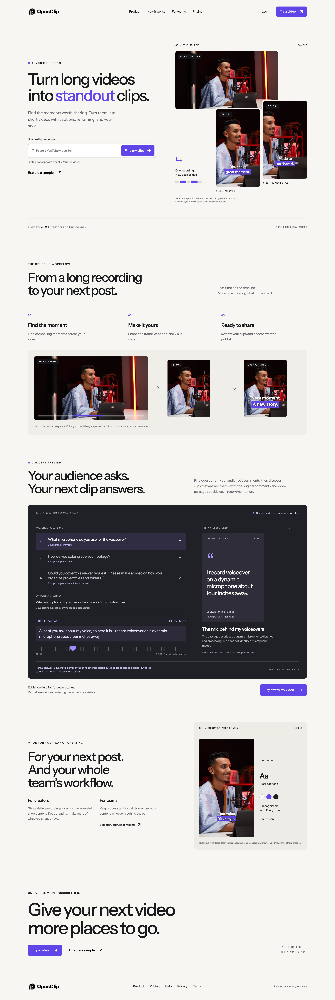

**Reading order:** core promise and video-link input → source-to-clips product sequence → audience-informed concept → creator and team relevance → closing action and footer.

The complete frame is an overview. The following pages provide readable details. Core OpusClip carries approximately 70% of the visual emphasis; the audience-informed concept adds a focused reason to explore.

## 2. The first impression

### Show the transformation before explaining the system.

1. **Recognizable identity.** The official logo anchors a new typography and layout system.
2. **One clear starting point.** The YouTube link is required; an optional goal appears in the workbench.
3. **Product-led composition.** One landscape source and two portrait crops explain the transformation. These are labeled licensed stock-still illustrations, not generated output.
4. **An explicit sample.** Visitors can inspect a synthetic scenario without live retrieval or paid generation.

“Find my clips” opens the workbench and starts live research when the coordinator and prerequisites are available. Otherwise it explains the unavailable state and offers an explicit sample. It never silently submits an OpusClip generation job.

The quiet 20M+ proof line is an attributed official company claim, not adoption of this proposed feature.

## 3. The audience-informed addition

### Your audience asks. Your next clip answers.

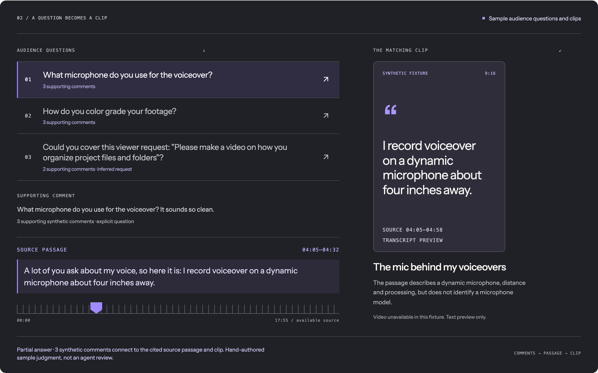

**Sample audience questions and clips — synthetic fixture; hand-authored marketing judgment.**

The coherent example is the microphone question: three synthetic comments support the question; the cited source passage runs from 04:05 to 04:32; the candidate clip contains the broader 04:05–04:58 range. The answer is partial because the passage describes a dynamic microphone and recording setup without naming a model.

The creator can inspect the question, original fixture wording, source passage, candidate clip, classification, and caveat. The text poster is not playable generated media. Synthetic evidence is not associated with the identifiable stock creator shown elsewhere on the page.

A question in a generation brief is not proof that a clip answers it. Recommendations require returned-content evidence. No-match and unverifiable outcomes remain visible.

## 4. The connected experience

### Research first. Generate deliberately. Review independently.

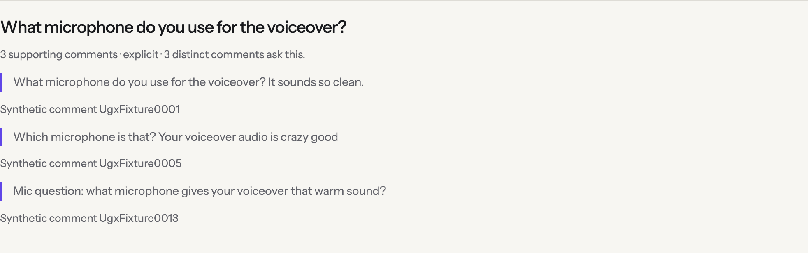
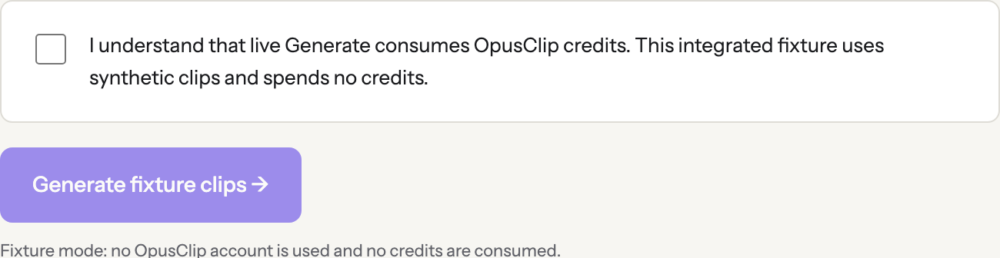
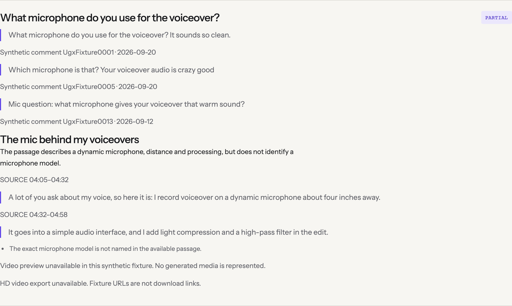

**Application handoff:** video link → audience research → creator acknowledges Generate → OpusClip processing → separate clip review → evidence and recommendations.

Research discovers supported questions. Review evaluates clips against that evidence. The coordinator persists IDs and an immutable handoff, so refresh observes existing work rather than regenerating it. Review/handoff retry and project reconciliation retain existing ownership; this marketing adapter exposes no force-new-project action.

**Capture status:** the integrated synthetic run reached research and generation, but review failed because no bound synthetic response matched its packet. The completed answer shown here is an explicitly labeled **offline hand-authored sample**, not an independent reviewer result. Live provider validation and end-to-end success are not claimed.

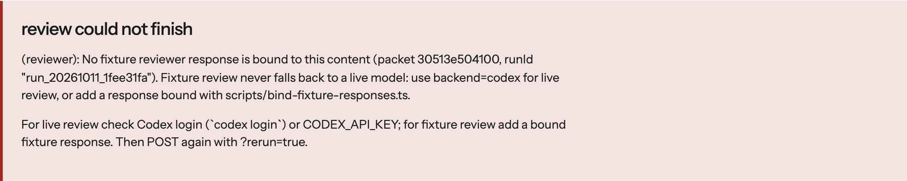

Missing comments, transcripts, useful matches, and processing failures remain distinct states. Fixture URLs are not offered as working previews or HD downloads.

## 5. The mobile experience

### The same hierarchy, recomposed for a smaller screen.

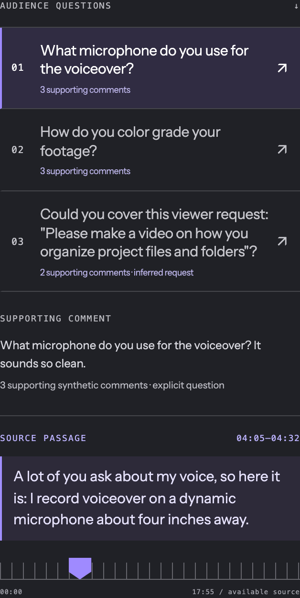
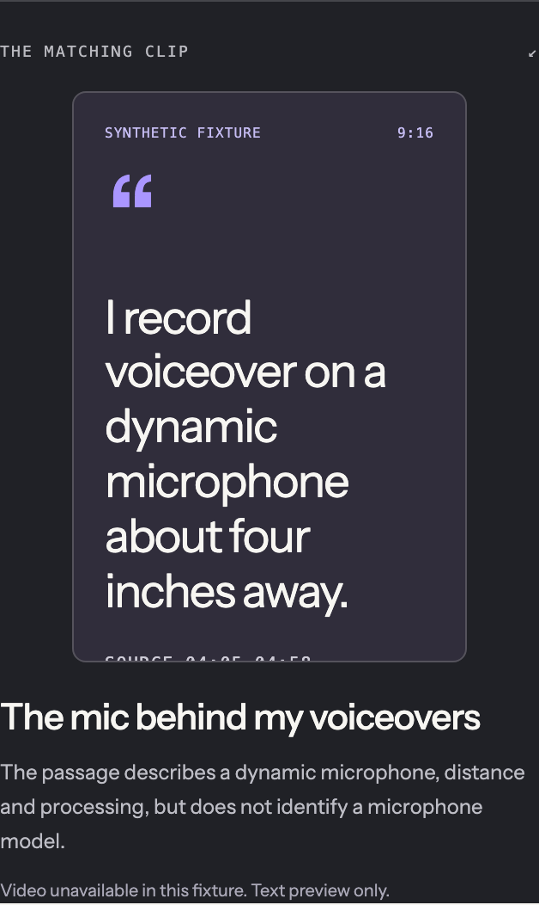

**Synthetic sample evidence; text preview only.**

The input and action stay easy to find. Source imagery follows the copy. Questions appear above their supporting comment and source passage, followed by the portrait preview. The relationship is preserved without shrinking a desktop diagram.

Mobile uses 20px gutters, a compact native disclosure menu, visible focus, and controls designed for at least 44px touch targets. Evidence is visible rather than tooltip-only. Question selection never starts audio; available video requires explicit loading/playback and is paused when the workbench closes.

## 6. The signature interaction

### Select a question. See the connection.

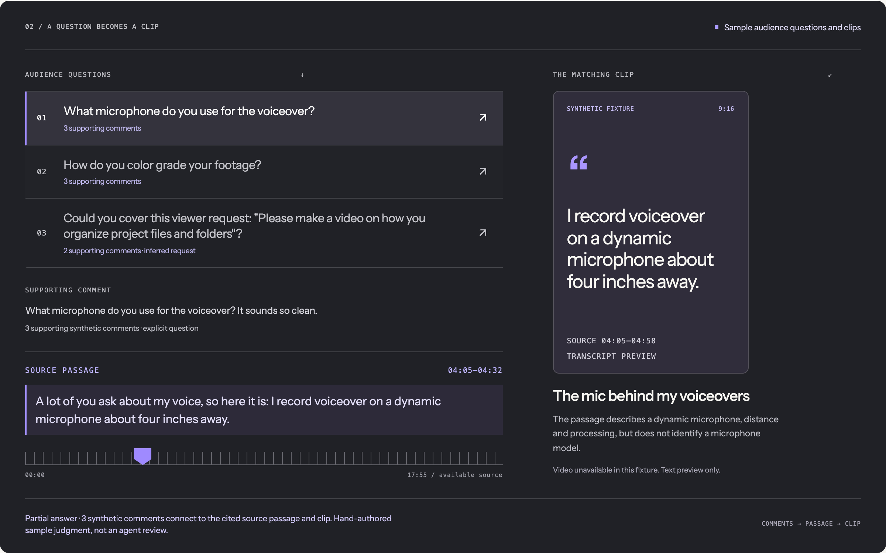
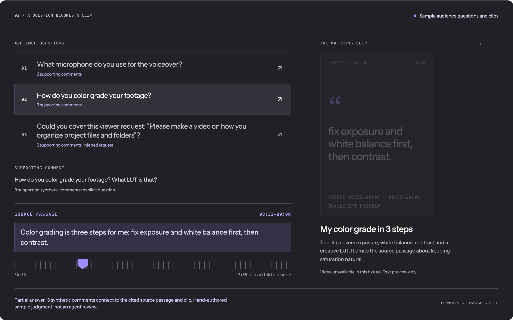
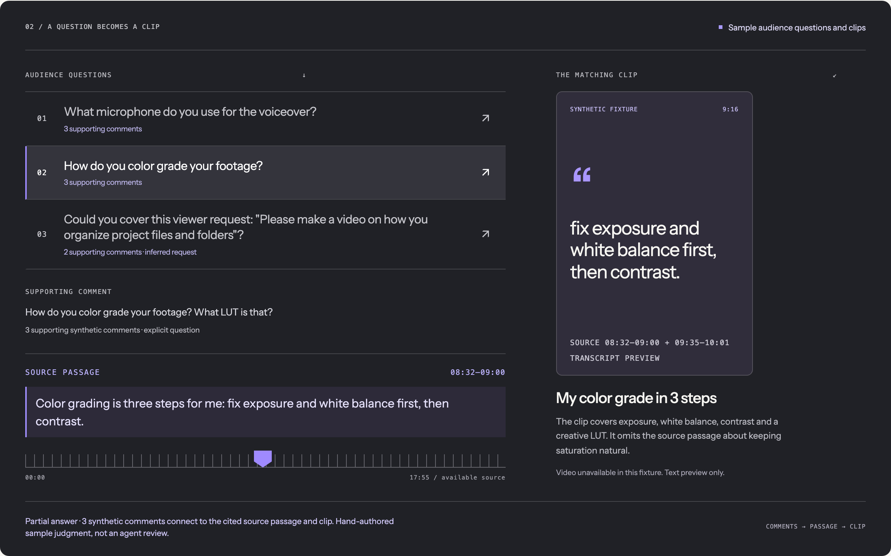

The three actual frames use one viewport and crop. The 100ms animation was paused for capture; product behavior was not changed. All frames are a labeled synthetic sample.

| Stage | Implemented behavior | Timing |
| --- | --- | --- |
| Selection | Native button changes `aria-pressed`; comments, passage, clip and explanation update immediately | 0ms |
| Evidence | Transcript highlight resolves to the selected evidence treatment | 0–180ms |
| Source | Marker moves to the relevant source position | 180–460ms; 280ms duration |
| Result | Matching text poster fades from 25% to full opacity | 420–600ms; 180ms duration |

A new selection cancels all earlier animation objects. Interaction is never locked. Question, passage and clip remain visible together. Source labels are not clip-playback timestamps. A polite relationship status provides the nonvisual explanation.

With reduced motion, content and marker position update immediately, without a moving marker or delayed fade. Playback remains a separate explicit action.

## 7. Visual system and build feasibility

### A small system that extends from homepage to workbench.

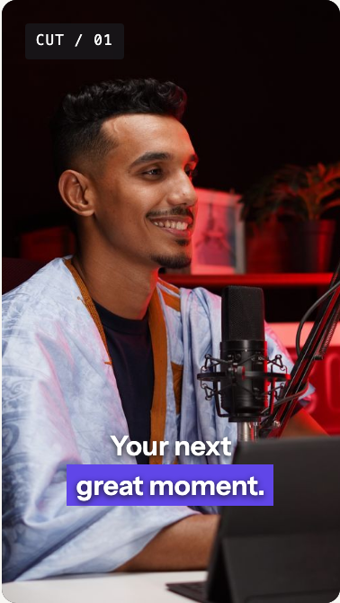

| Element | Implemented specification |
| --- | --- |
| Canvas | Warm white, #F7F6F2 |
| Primary text | Near-black, #191A1D |
| Secondary text | #62636A |
| Brand accent | Violet, #6046E8 |
| Dividers | #DEDCD6 |
| Media stage | Charcoal, #202126 |
| Typography | Self-hosted Instrument Sans; sparse system monospace |
| Layout | 1200px maximum; twelve-column desktop grid; native mobile stack |
| Shape | Approximately 8px button and 12px panel radii |

**Webflow:** static sections map to standard containers, grids, reusable typography, buttons, steps, and media-frame components. **Application:** the workbench owns coordinator requests, job observation, evidence, media and recovery controls. **Optional Rive:** a future marker asset may animate source position; text and controls remain semantic HTML. No native Webflow or Rive source file is claimed.

Reserved media dimensions, self-hosted fonts, poster-first imagery, explicit video loading and reduced-motion support keep the system practical.

Independent redesign concept. Core product descriptions and the company proof claim are based on [OpusClip’s homepage](https://www.opus.pro/) and [media kit](https://media.opus.pro/). Audience-informed research/review are proposed additions; no engagement or conversion uplift is claimed. Broader editing, publishing and team administration link to the official product rather than being presented as local prototype features.
