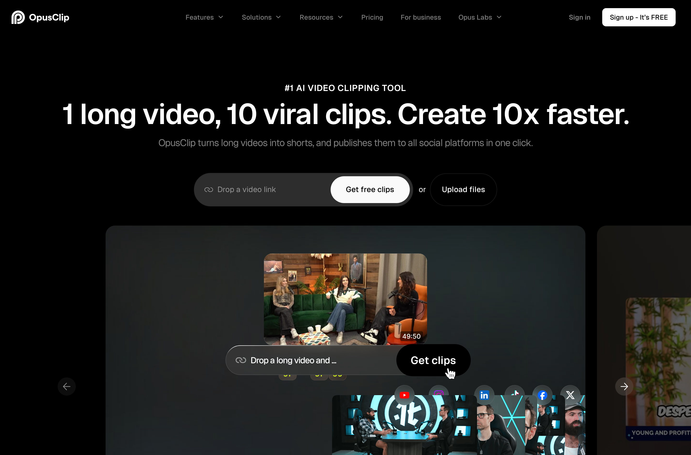
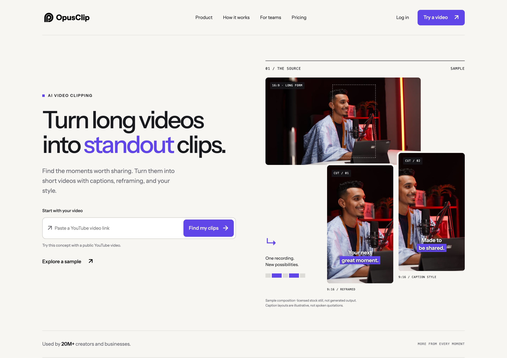

# OpusClip — Rebrand thesis
## A more considered creative partner

### 1. The direction

## Turn long videos into standout clips.

OpusClip already makes its core promise easy to understand: a long video becomes short clips. Its current homepage leads with “1 long video, 10 viral clips” and “Create 10x faster,” supported by a broad catalogue of capabilities. That emphasis communicates speed and output. Our direction makes the creative decisions behind that output more visible.

The redesign presents OpusClip as a confident editing partner: finding moments worth sharing, giving them a distinct visual form, and keeping creators close to the decisions that matter. The product promise stays familiar. The experience becomes calmer, more deliberate, and easier to inspect.

## The principle: make the value visible.

Every major visual element has a job: show the source, the crop, the caption treatment, or the question a clip might answer. Typography establishes hierarchy. Motion explains a relationship rather than decorating the page.

Swiss editorial discipline meets the vocabulary of a film contact sheet: warm-white space, near-black Instrument Sans, restrained violet, precise alignment, fine rules, and discreet source-time labels. The implemented hero uses a licensed stock still in landscape and portrait compositions, clearly labeled illustrative—not generated output or spoken quotations.

## Why this fits OpusClip

OpusClip’s homepage states that it is used by 20M+ creators and businesses. A brand serving that breadth should feel approachable to an individual creator and credible to a professional team. Clear typography and a consistent product-led system serve both, without changing the company’s name or logo.

The same visual language can explain clipping, captioning, reframing, and future workflows while maintaining one identity. The official logo remains the point of recognition; the surrounding experience carries the evolution.

*Preserve the immediate video-to-clips promise; give the material and creative decisions more space.*

### 2. The proof

## One homepage, one focused addition

Approximately 70% of the page’s emphasis remains on the core OpusClip product. The link-entry hero, source-to-clips composition, compact workflow, creator/team relevance, and closing action keep the homepage recognizable. A distinct charcoal evidence stage introduces the audience-informed addition without becoming a separate research brand.

The proposed workflow connects three responsibilities: audience research discovers supported questions; OpusClip generates candidate clips after an explicit credit-acknowledged action; a separate review agent evaluates whether those clips answer the questions. Ordinary application code coordinates their handoff and retains job identifiers.

Question, comment, passage, and clip stay visible together. Partial answers, missing transcripts, and no-match outcomes remain legitimate results. A generation prompt is not evidence that a clip answers a question, and partial source coverage cannot establish absence from the entire video.

## A system the team can build

Reusable containers, grids, typography, buttons, and media frames translate into standard Webflow components. The workbench is an embedded application module using the coordinator’s actual routes. A small Web Animations API layer implements the timeline connection; a future Rive asset may replace only the decorative marker. Evidence, controls, and playback remain semantic HTML.

The page and offline sample are implemented. The connected fixture capture reached research and generation, but review was blocked by an unmatched synthetic response binding. The displayed completed sample is an explicitly hand-authored offline storyboard, not independent live review. No live end-to-end success or performance improvement is claimed.

## What we would evaluate

Does audience evidence help creators choose what to publish? Proposed measures are time to the first creator-approved clip, the share of sessions reaching that point, and creator agreement that the clip answers the cited question. These are evaluation criteria, not measured gains.

| Current emphasis | Proposed emphasis |
| --- | --- |
| Speed and volume | A clear clipping promise plus visible creative decisions |
| Breadth of capabilities | A coherent source-to-useful-result journey |
| Engagement potential | Engagement potential plus inspectable audience relevance |

Sources: [OpusClip homepage](https://www.opus.pro/) and [official media kit](https://media.opus.pro/), reviewed October 11, 2026. The 20M+ claim describes the existing company, not use of this concept. Stock photo: [Pexels 36917944](https://www.pexels.com/photo/podcast-host-in-recording-studio-with-microphone-36917944/) under the [Pexels license](https://www.pexels.com/license/). Instrument Sans: SIL Open Font License. Independent redesign concept; not an official release.
